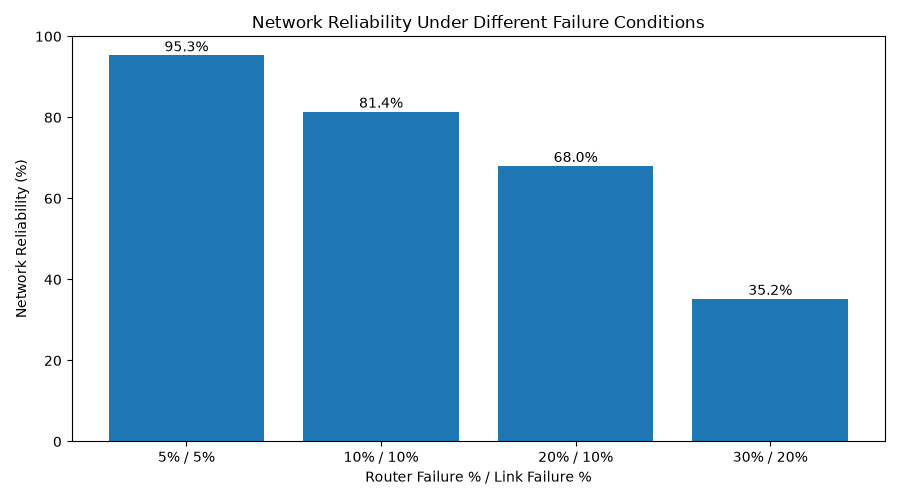

### WINDOWS SETUP

Step 1: Install python3

Step 2: 

### LINUX SETUP

Linux: Step 1: Go to the terminal Step 2: run this command

sudo apt install python3

### MACOS SETUP

macOS

Step 1: Go to your application folder -> Utilities -> Terminal

Step 2: Type "python3" into the terminal

Step 3: Click "Finder" -> Click "Applications" -> Click "Utilities" -> Click "Terminal"

Step 4: Go to the directory where the code is at:
cd git
cd dynamic-routing-faulty-network

Step 5: Type the following command: "python3 Dynamic-Routing-Faulty-network"

# Dynamic-Routing Mechanism Design in a Faulty Network

## Network Diagrams

### Network Before Failure

### Network After Router Failure

### Network With Random Failures

## Network Reliability Comparison

The network was tested under four different failure conditions.
Each test included 1,000 simulation rounds.

| Router Failure | Link Failure | Reliability |
|---|---|---|
| 5% | 5% | 95.3% |
| 10% | 10% | 81.4% |
| 20% | 10% | 68.0% |
| 30% | 20% | 35.2% |

### Reliability Comparison Graph

### Results

The results show that network reliability decreases as router
and link failure probabilities increase.

At low failure rates, the network maintained a working route
in most simulation rounds.

At higher failure rates, finding an available route became
more difficult.
